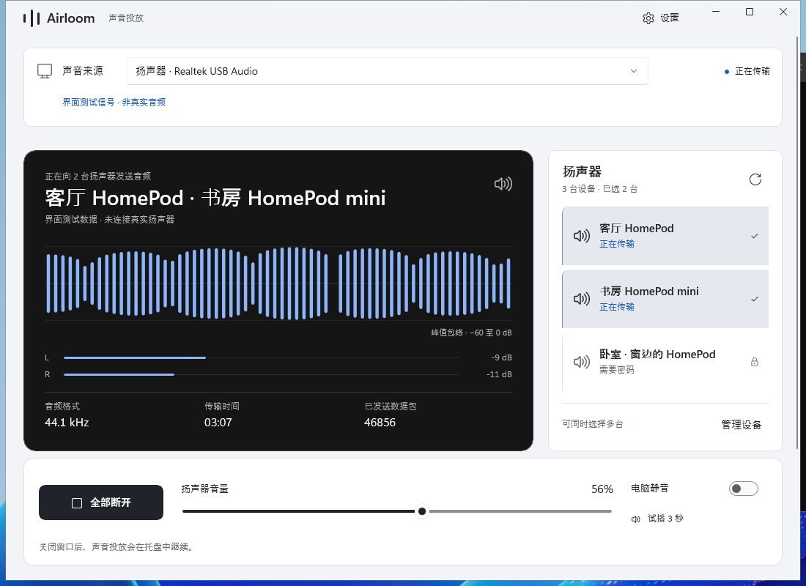
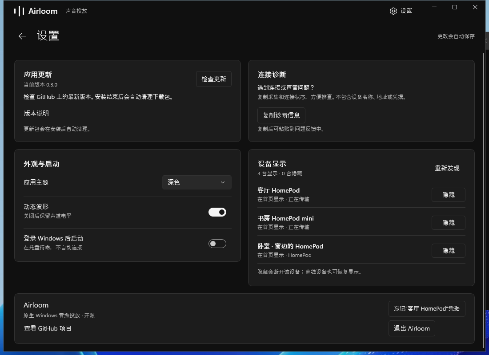

# Airloom

**让 Windows 的声音，流向 HomePod。**

一个从零实现的 Windows 原生音频投放应用：WinUI 3 界面、Rust 音频核心、Windows 自带音频采集。无需安装自定义虚拟声卡驱动。

> **Latest · 0.3.0**：完整重做原生界面，采用银灰工作区、深色音频仪表、紧凑扬声器列表和固定播放控制栏。用户已反馈 0.2.1 在其 HomePod 上恢复出声；本版沿用这一音频核心。

[](https://github.com/chummumm/airloom/actions/workflows/ci.yml)
[](LICENSE)

## 界面





以上是实际 WinUI 3 程序的 Windows 截图。`fixture-*` 使用独立临时目录中的 CI 专用替代 DLL，提供两台正在传输的扬声器、第三台需要密码的设备与模拟信号，用于检查界面完整状态；这些数据和替代 DLL 不进入安装包，也不作为实机音频证明。

发布程序本体另有[浅色空状态](docs/evidence/native-home-light.png)、[深色空状态](docs/evidence/native-home-dark.png)及[设置页](docs/evidence/native-settings-light.png)截图。Windows CI 从最终便携 ZIP 启动程序，检查 880／1100／1600 像素窗口、固定播放栏、音量数值和实际鼠标拖动、深浅主题、设置导航、诊断复制与真实 GitHub 更新检查。

## 体验

- **原生界面**：WinUI 3 / C++/WinRT，紧凑音源条、深色音频仪表、自适应扬声器列表与固定底部播放栏；支持深浅主题、系统高对比度和减少动画偏好。
- **实时展示**：由真实 PCM 驱动的 64 段峰值包络、左右声道电平和传输指标；固定 −60 至 0 dB 显示标尺，没有音频时显示平线。
- **免驱投放**：采集系统默认或指定的现有输出设备，通过局域网向 AirPlay 接收端发送。
- **多设备投放**：一次采集，同一份音频发往多个独立连接。可在播放中选择、取消或重试单台设备；一台等待密码或连接失败，不会停止其他设备。
- **密码与配对**：区分设备密码、配对码、长期配对凭据；认证失败可以重新输入。记住凭据需要主动勾选，存入 Windows 当前用户的凭据管理器。
- **独立设置页**：优先显示更新和连接诊断；管理主题、波形、登录启动和设备可见性。隐藏选择会保留，离线设备也可恢复显示。
- **应用内更新**：检查 GitHub 最新正式版本，下载并校验 SHA-256，退出后安装并重新打开。成功、取消或失败后的包会清理；中断和占用残留在后续启动时重试。
- **托盘控制**：单击打开窗口，右键控制；托盘退出真正结束后台。登录自启可选。
- **本机静音**：可选，默认关闭；停止时只恢复仍由当前会话拥有的变更，不覆盖用户后来手动修改的状态。

## 下载与运行

下载 [Airloom 0.3.0 · Latest](https://github.com/chummumm/airloom/releases/latest)：

**从 0.1.x / 0.2.0 升级这一次，请先右键系统托盘中的 Airloom →“退出 Airloom”，再运行新安装包。** 关闭旧版窗口只会隐藏到托盘；旧版没有新的安装退出协议，新安装器会提示先退出。装上 0.2.1 后，后续安装会使用新的进程退出与等待流程。详见[版本说明](docs/releases/0.3.0.md)。

| 文件 | 用途 |
| --- | --- |
| [Airloom-0.3.0-setup-x64.exe](https://github.com/chummumm/airloom/releases/download/v0.3.0/Airloom-0.3.0-setup-x64.exe) | 按当前用户安装 |
| [airloom-windows-x64-portable.zip](https://github.com/chummumm/airloom/releases/download/v0.3.0/airloom-windows-x64-portable.zip) | 完整解压到新目录后运行 |
| [SHA256SUMS.txt](https://github.com/chummumm/airloom/releases/download/v0.3.0/SHA256SUMS.txt) | 两个下载文件的完整性校验值 |

0.3.0 来自[全部检查通过的构建](https://github.com/chummumm/airloom/actions/runs/39573924973)，源码提交为 `e80e6f9af8707216277fa8396dd351eaf33fad73`。发布页保留真实原生程序截图、明确标注来源的多设备／密码状态截图以及完整界面检查结果。后续开发构建可在 [Actions](https://github.com/chummumm/airloom/actions/workflows/ci.yml) 的 `airloom-windows-x64` Artifact 中获取。

要求 Windows 11 x64（build 22000 或更高）。电脑与接收端需处于可以互相发现和通信的局域网。解压便携 ZIP 后运行 `Airloom.exe`，或运行安装包。不要只复制 EXE：原生应用和 Windows App SDK 的自包含文件需要放在一起。

1. 打开 Airloom，等待发现设备；必要时点击重新扫描。
2. 选择一台或多台 HomePod，以及声音来源。
3. 点击开始投放；按提示输入设备密码或配对码。
4. 如需只由接收端播放，可尝试“静音本机”，并确认接收端仍有声音。

程序不需要 Apple Account 密码。Windows 声音输出列表不会新增“Airloom 声卡”；投放设备在本应用中选择。

如果波形正常但音响无声，可先按“试播 3 秒”发送独立测试音，然后保持连接，进入设置 → 连接诊断 →“复制诊断信息”。反馈时附上这段文本，便于区分采集、时钟同步、发送和接收端响应问题；它不包含设备名称、网络地址、标识、密码或密钥。波形与发送包数不能单独证明接收端已经播放。

在设置中点击“检查更新”可获取后续正式版本。应用内更新使用安装程序更新当前运行目录，清理仅限 Airloom 自己的更新缓存；手动下载到“下载”文件夹的安装包不在清理范围内。详见[更新设计与验证](docs/updates.md)。

## 已实现的代码与验证边界

| 项目 | 当前范围 |
| --- | --- |
| 原生窗口、设置、设备/声源选择、认证界面、波形和托盘 | 独立 WinUI 3 工程；Windows CI 检查最终便携包启动、三尺寸布局、固定播放栏、实际拖动、深浅主题、设置导航、诊断复制和在线更新；独立模拟数据用于填充状态和密码对话框的视觉检查 |
| Windows 音频 | 已有端点的 WASAPI 共享模式 loopback；格式转换、双声道重采样、有界缓冲 |
| 单独应用采集 | 暂未提供，不在 UI 展示未实现选项 |
| AirPlay | 设备发现、独立认证/会话/音频发送实现，详见协议文档 |
| 密码保护 | 有协议与 UI 实现；需要逐型号、固件和访问策略实测 |
| 多设备 | 独立发送队列、认证与恢复，共用一次采集；自动测试验证分发完整性和故障隔离，真实多音响效果待测 |
| 更新与包清理 | 原生助手通过校验拒绝、成功/取消、重启与缓存清理检查；真实 WinUI 进程通过安装退出、托盘清理及 Restart Manager 查询/取消/确认退出检查 |
| 实际播放延迟 | 尚未测量，不把接收缓冲设置当作端到端实测值 |
| HomePod 立体声组合、多房间同步 | 未验证 |
| 真实 HomePod 实机结果 | 用户已反馈 0.2.1 在其 HomePod 上恢复出声；其他型号、固件、立体声组合及多设备同步仍需逐项验证 |

本次发布的 Linux 常规测试 73 项、Windows 常规测试 71 项全部通过。Linux 另通过 FFmpeg 对完整 RTP 加密负载解密后的 ALAC 独立解码检查；Windows 未安装 FFmpeg，该项在那里跳过。回归覆盖独立规范字节 fixture、完整 gPTP 扩展、连续时钟就绪、SETPEERS 后才开始公告的接收端、完整加密会话与非零 PCM 解码，以及多设备分发与故障隔离。原生更新检查使用真实 WinUI 进程验证退出，并用本地安装 fixture 验证后续安装和清理；它不等于已经在线覆盖安装了一台用户电脑。这些检查均不替代真实 HomePod 播放测试。

WASAPI 采集不会自动改变应用的本地输出路由。独占模式、受保护内容、声卡特有音效和静音位置可能影响采集。没有声卡驱动签名问题，但公开下载的预览应用/安装包仍可能出现系统的发布者或信誉提示。

## 构建

### Rust 核心

```sh
cargo test --workspace --locked
cargo clippy --workspace --all-targets --locked -- -D warnings
cargo fmt --all -- --check
```

非 Windows 系统可以运行协议和音频算法测试；实际 Windows 音频采集与凭据存储会明确返回不支持。

### Windows 完整应用

安装 Visual Studio 2022 或 2026 的 C++ 桌面开发与 WinUI/C++ 工具组件、Windows SDK 10.0.26100.0、Rust MSVC 工具链、NuGet CLI 和 Python 3（用于收集依赖许可证）。工程会根据 Visual Studio 版本选择 v143 或 v145 工具集。在开发者 PowerShell 中执行：

```powershell
./scripts/build-windows.ps1 -Configuration Release
./scripts/package-windows.ps1
```

第二步需要 Inno Setup 6。输出在 `dist/`。完整步骤也可参考 [Windows CI](.github/workflows/ci.yml)。

## 结构

| 目录 | 内容 |
| --- | --- |
| `native/Airloom` | WinUI 3 / C++/WinRT 原生应用 |
| `native/Updater` | 独立更新助手、下载校验与缓存清理 |
| `crates/airloom-core` | 用户操作、连接状态、会话调度、C ABI |
| `crates/airloom-capture` | Windows 音频采集和凭据存储 |
| `crates/airloom-airplay` | 独立 AirPlay 发现、认证和发送器 |
| `scripts`、`installer` | 构建、检查、打包 |
| `docs` | 设计、协议、兼容性边界 |

参见 [架构](docs/architecture.md)、[界面设计](docs/design.md)、[Windows 音频](docs/windows-audio.md)、[协议](docs/protocol.md)、[贡献指南](CONTRIBUTING.md)。

## 开源

Airloom 原创代码使用 [MIT License](LICENSE)。依赖保留各自许可证，见 [第三方声明](THIRD_PARTY_NOTICES.md)。项目不包含其他投放软件的应用代码分支。HomePod 和 AirPlay 是 Apple 的商标；本项目与 Apple 无隶属关系。
