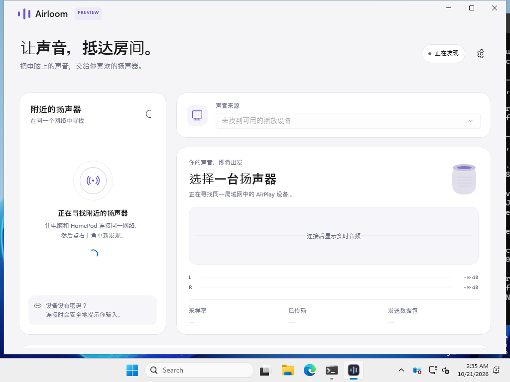

# Airloom

**让 Windows 的声音，流向 HomePod。**

一个从零实现的 Windows 原生音频投放应用：WinUI 3 界面、Rust 音频核心、Windows 自带音频采集。无需安装自定义虚拟声卡驱动。

> **开发中 · 0.1.1**：已提供 Windows 安装包和便携版，并通过原生编译、打包启动及协议自动化检查。真实 HomePod 的播放与兼容性尚待实机验证；当前不承诺全型号、全固件、立体声组合或所有访问控制策略可用。

[](https://github.com/chummumm/airloom/actions/workflows/ci.yml)
[](LICENSE)

## 界面



这是首版 0.1.0 便携 ZIP 解压后实际启动的 WinUI 3 窗口，0.1.1 保留相同界面布局。CI 没有可用的播放设备，也未连接 HomePod，因此截图显示真实的发现空状态。小屏幕下可向下滚动访问开始投放、音量和静音控制。

## 体验

- **原生界面**：WinUI 3 / C++/WinRT，深浅主题、Mica 背景、设备卡片、连接状态过渡。
- **实时展示**：由真实音频驱动的波形、左右声道电平和传输指标；没有音频时显示平线，不生成假设备或假播放状态。
- **免驱投放**：采集系统默认或指定的现有输出设备，通过局域网向 AirPlay 接收端发送。
- **密码与配对**：区分设备密码、配对码、长期配对凭据；认证失败可以重新输入。记住凭据需要主动勾选，存入 Windows 当前用户的凭据管理器。
- **托盘控制**：单击打开窗口，右键控制；托盘退出真正结束后台。登录自启可选。
- **本机静音**：可选，默认关闭；停止时只恢复仍由当前会话拥有的变更，不覆盖用户后来手动修改的状态。

## 下载与运行

下载 [Airloom 0.1.1 · Latest](https://github.com/chummumm/airloom/releases/latest)：

0.1.1 修正首次建立会话时可能导致 `session SETUP 400` 的 MAC 地址格式、PTP 时钟整数编码及 peer 字段问题。升级前先从托盘退出旧版，再运行新安装包；详见[版本说明](docs/releases/0.1.1.md)。

| 文件 | 用途 |
| --- | --- |
| [Airloom-0.1.1-setup-x64.exe](https://github.com/chummumm/airloom/releases/download/v0.1.1/Airloom-0.1.1-setup-x64.exe) | 按当前用户安装，约 40 MB |
| [airloom-windows-x64-portable.zip](https://github.com/chummumm/airloom/releases/download/v0.1.1/airloom-windows-x64-portable.zip) | 完整解压即可运行，约 60 MB |
| [SHA256SUMS.txt](https://github.com/chummumm/airloom/releases/download/v0.1.1/SHA256SUMS.txt) | 两个下载文件的完整性校验值 |

0.1.1 来自[全部检查通过的构建](https://github.com/chummumm/airloom/actions/runs/39536144084)，源码提交为 `e82e0e2b1e16f41762244fb1e22614e40d04527d`。发布页也保留原生窗口截图与启动检查结果。后续开发构建可在 [Actions](https://github.com/chummumm/airloom/actions/workflows/ci.yml) 的 `airloom-windows-x64` Artifact 中获取。

要求 Windows 11 x64（build 22000 或更高）。电脑与接收端需处于可以互相发现和通信的局域网。解压便携 ZIP 后运行 `Airloom.exe`，或运行安装包。不要只复制 EXE：原生应用和 Windows App SDK 的自包含文件需要放在一起。

1. 打开 Airloom，等待发现设备；必要时点击重新扫描。
2. 选择 HomePod 和声音来源。
3. 点击开始投放；按提示输入设备密码或配对码。
4. 如需只由接收端播放，可尝试“静音本机”，并确认接收端仍有声音。

程序不需要 Apple Account 密码。Windows 声音输出列表不会新增“Airloom 声卡”；投放设备在本应用中选择。

## 已实现的代码与验证边界

| 项目 | 当前范围 |
| --- | --- |
| 原生窗口、设备/声源选择、认证界面、波形和托盘 | 独立 WinUI 3 工程，使用真实引擎状态；Windows CI 编译、打包及便携包窗口启动通过 |
| Windows 音频 | 已有端点的 WASAPI 共享模式 loopback；格式转换、双声道重采样、有界缓冲 |
| 单独应用采集 | 暂未提供，不在 UI 展示未实现选项 |
| AirPlay | 设备发现、独立认证/会话/音频发送实现，详见协议文档 |
| 密码保护 | 有协议与 UI 实现；需要逐型号、固件和访问策略实测 |
| 实际播放延迟 | 尚未测量，不把接收缓冲设置当作端到端实测值 |
| HomePod 立体声组合、多房间同步 | 未验证 |
| 真实 HomePod 实机结果 | 已收到首个 SETUP 400 的报告并修正请求格式；等待 0.1.1 实机复测 |

本次发布的 Linux 常规测试 44 项、Windows 常规测试 42 项全部通过。Linux 另通过 FFmpeg 对 ALAC 的独立解码检查；Windows 未安装 FFmpeg，因此该项在那里跳过。其中包含 4 项新增 SETUP 字段与二进制编码回归。认证验证包含独立 SRP 数学向量，以及合成接收端上的密码、PIN、重新验证、加密音频与错误密码拒绝流程。这些检查不替代真实 HomePod 播放测试。

WASAPI 采集不会自动改变应用的本地输出路由。独占模式、受保护内容、声卡特有音效和静音位置可能影响采集。没有声卡驱动签名问题，但公开下载的预览应用/安装包仍可能出现系统的发布者或信誉提示。

## 构建

### Rust 核心

```sh
cargo test --workspace --locked
cargo clippy --workspace --all-targets --locked -- -D warnings
cargo fmt --all -- --check
```

非 Windows 系统可以运行协议和音频算法测试；实际 Windows 音频采集与凭据存储会明确返回不支持。

### Windows 完整应用

安装 Visual Studio 2022 或 2026 的 C++ 桌面开发与 WinUI/C++ 工具组件、Windows SDK 10.0.26100.0、Rust MSVC 工具链、NuGet CLI 和 Python 3（用于收集依赖许可证）。工程会根据 Visual Studio 版本选择 v143 或 v145 工具集。在开发者 PowerShell 中执行：

```powershell
./scripts/build-windows.ps1 -Configuration Release
./scripts/package-windows.ps1
```

第二步需要 Inno Setup 6。输出在 `dist/`。完整步骤也可参考 [Windows CI](.github/workflows/ci.yml)。

## 结构

| 目录 | 内容 |
| --- | --- |
| `native/Airloom` | WinUI 3 / C++/WinRT 原生应用 |
| `crates/airloom-core` | 用户操作、连接状态、会话调度、C ABI |
| `crates/airloom-capture` | Windows 音频采集和凭据存储 |
| `crates/airloom-airplay` | 独立 AirPlay 发现、认证和发送器 |
| `scripts`、`installer` | 构建、检查、打包 |
| `docs` | 设计、协议、兼容性边界 |

参见 [架构](docs/architecture.md)、[界面设计](docs/design.md)、[Windows 音频](docs/windows-audio.md)、[协议](docs/protocol.md)、[贡献指南](CONTRIBUTING.md)。

## 开源

Airloom 原创代码使用 [MIT License](LICENSE)。依赖保留各自许可证，见 [第三方声明](THIRD_PARTY_NOTICES.md)。项目不包含其他投放软件的应用代码分支。HomePod 和 AirPlay 是 Apple 的商标；本项目与 Apple 无隶属关系。
